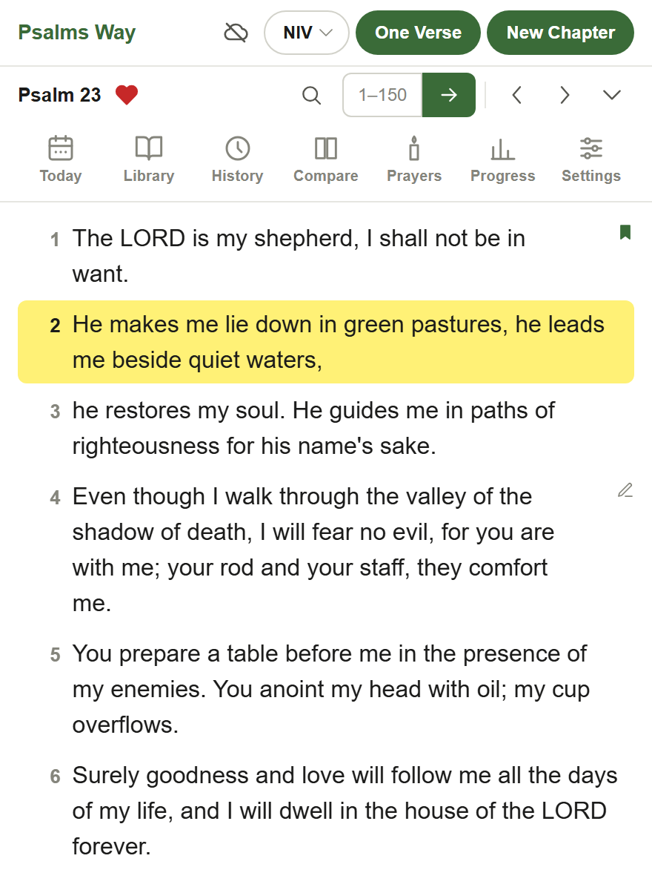
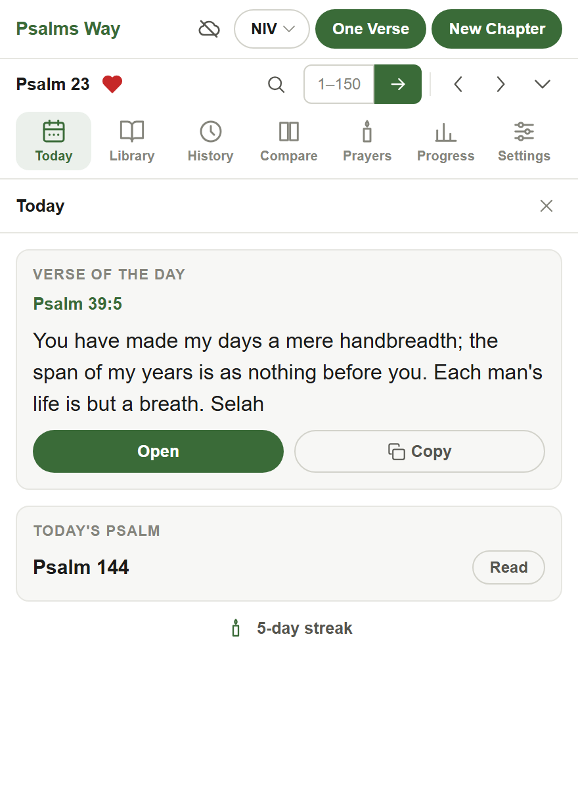
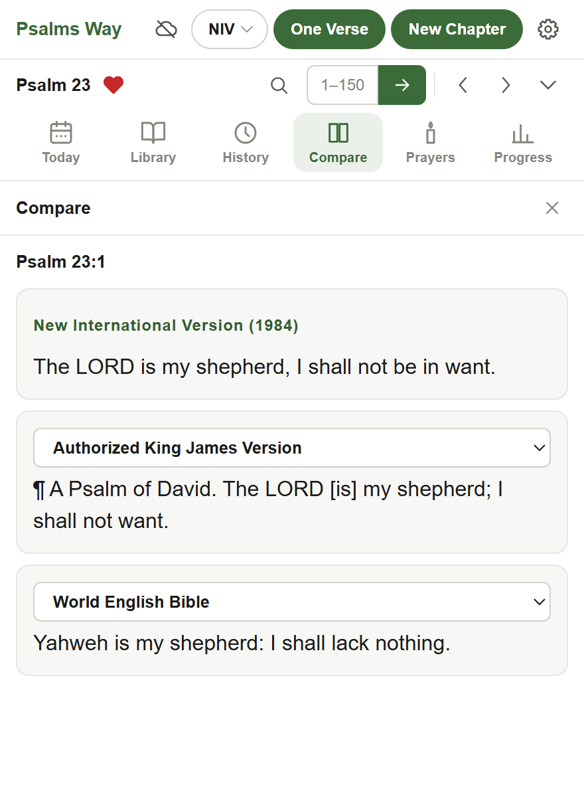
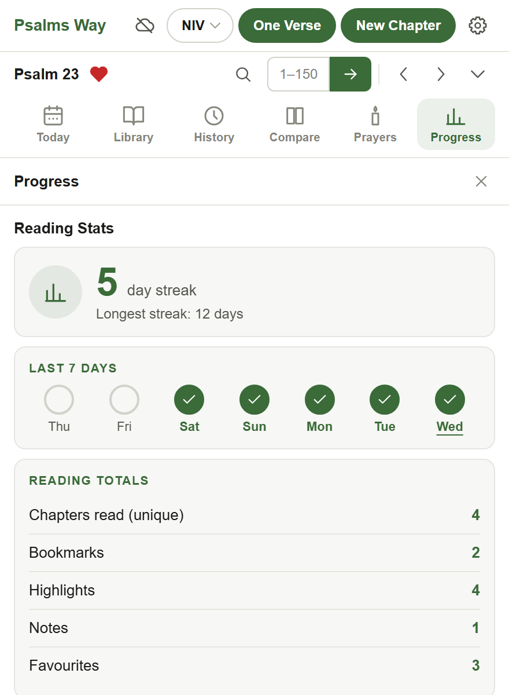
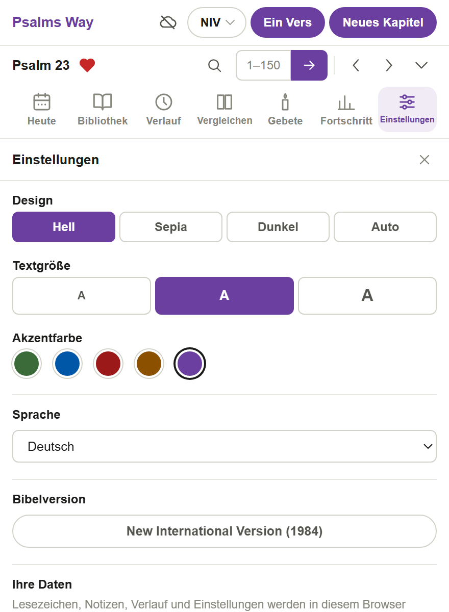
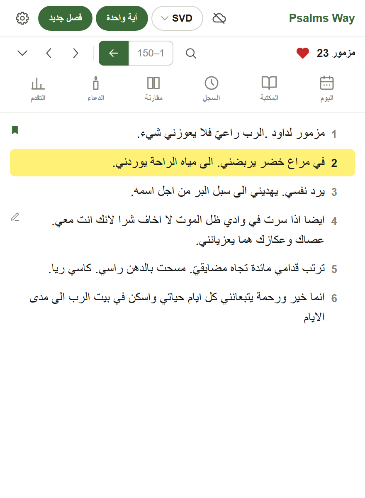

<div align="center">


# Psalms Way

**A Biblical pause before new beginnings. All 150 Psalms in the browser toolbar, in 80 Bible versions and 47 languages, offline, with optional sync to the Psalms Way phone app.**

[](https://github.com/atj393/psalms-way-browser-extension/actions/workflows/ci.yml)
[](https://chromewebstore.google.com/detail/psalms-way-biblical-begin/aplafmlmecdjlmcgbibmlbjnilcomcnl)
[](LICENSE)
[](manifest.json)
[](#privacy)

</div>

---

Psalms Way puts all 150 Psalms in a browser popup, in 80 Bible versions and 47
interface languages. Every version is bundled with the extension, so it opens
instantly and works with the network disconnected. An account is optional: connect
the same Google account as the Psalms Way phone app and your bookmarks, notes,
highlights, favourite Psalms, history and progress stay the same on both.

<div align="center">








</div>

More are in [docs/screenshots](docs/screenshots): the version picker, the Library,
Prayers, search, History and the dark and sepia themes.

## What it does

**Reading**

- **80 Bible versions** in 46 languages, grouped by language in a picker with a
  filter box and each version's credit line. English readers start on the NIV
  (1984); other readers start on a version in their browser's language when there
  is one. Change it any time from the version chip at the top.
- **Today** — the verse of the day (the same verse the phone app shows on the same
  version), Today's Psalm, and your reading streak. Today's Psalm is one chapter per
  calendar day, derived from the date rather than stored.
- **Random verse** and **random chapter**.
- Previous, next, or jump straight to a chapter number.
- Select any verse to bookmark it, highlight it, note it, copy it or compare it.
- Reopens where you left off.

**Your library**

- **Bookmarks** — keep any verse and find it again.
- **Highlights** — colour a verse yellow, green, blue or pink, the phone app's four
  colours. The verse keeps its tint when you read it.
- **Favourites** — click the heart beside a Psalm's title to keep the whole Psalm.
- **Notes** — write a short note on a verse, edit it, delete it, and jump back to
  the verse from the Library.
- **History** — recently read passages, newest first.

**Finding things**

- Keyword search across all 150 chapters of the version you are reading, with
  matches highlighted and the count reported. Results open the exact verse that
  matched. The Search button sits beside the Psalm number.

**Compare and pray**

- **Compare** — one verse in the version you are reading and two others you choose
  (King James and World English to begin with).
- **Prayers** — 50 prayers in 19 categories, each with its Scripture references;
  click a reference to open that Psalm, or copy the prayer. The prayers are in
  English, as in the phone app.

**Progress**

- Your reading streak and longest streak, the last seven days, and reading totals.
- The phone app's nine streak badges and six reading challenges. Start a challenge,
  mark each day's reading done (one day counts per calendar day) or reset it.
  When you connect sync, streaks, badges and challenges carry on between the phone
  and the browser.

**Appearance and language**

- Light, sepia, dark and auto (follows your system) themes; five accent colours;
  three text sizes; a collapsible toolbar. All remembered.
- 47 languages, chosen automatically from your browser or in Settings, with
  right-to-left layout for Arabic, Persian, Hebrew, Urdu and Uyghur.

**Your data**

- Export everything you keep (bookmarks, notes, highlights, favourite Psalms,
  history, progress and settings) to a JSON file and restore it on another browser
  or profile.
- Optional sync with the Psalms Way phone app through your own Google Drive.
- There are no reminders or notifications.

## Install

- **Chrome and Edge:** [Chrome Web Store listing](https://chromewebstore.google.com/detail/psalms-way-biblical-begin/aplafmlmecdjlmcgbibmlbjnilcomcnl)
- **From source:**
  1. Clone this repository.
  2. Open `chrome://extensions` and enable **Developer mode**.
  3. Click **Load unpacked** and select the cloned folder.

  There is nothing to build. `npm install` is only needed to run the tests.

See [USER_GUIDE.md](USER_GUIDE.md) for a walkthrough of each panel.

## Privacy

The extension requests one permission, `storage`. Connecting sync asks for one
more, `identity` (Google sign-in), at that moment and not before.

- **No network requests unless you connect sync.** Every Bible version and
  language is bundled in the extension. Export and restore read and write a local
  file you choose. The
  browser smoke test fails the build if the popup makes any request.
- **Sync is optional and goes only to your own Google Drive.** It uses a private
  app folder that only Psalms Way can see (the `drive.appdata` scope), not your
  files. Requests go straight from your browser to Google; there is no Psalms
  Way server and we never receive your data.
- **No host permissions and no content scripts**, so the extension cannot see,
  read or modify any page you visit. `scripts/validate-manifest.js` fails the
  build if either is ever added.
- **No analytics and no telemetry.** The Google account for sync is optional.
- Bookmarks, notes, highlights, favourite Psalms, history, progress and settings are
  held in `chrome.storage.local` on your own machine. Without sync they are removed if you uninstall the extension;
  connect sync or export a backup first if you want to keep them.

## How it is built

Plain HTML, CSS and JavaScript. Manifest V3, no framework, no bundler, no runtime
dependencies, and no build step: the files in the repository are the files that
ship.

```
manifest.json     popup.html     style.css     psalms.json (the NIV)
styles/           one stylesheet per feature, and the accent colours
bibles/           the other 79 Bible versions, and index.json, the catalogue
locales/          app/ the phone app's translations, ext/ the extension's wording
data/             prayers-en.json, the phone app's prayers
src/
  app.js          bootstrap, view switching, focus management
  reader.js       the reading view and the verse actions
  panels.js       search, Library and history lists
  notes.js        the note editor
  settings.js     appearance, language, export and restore
  versions.js     the catalogue, the chosen version and its text
  versionPicker.js  the Bible version panel
  i18n.js         the interface language: t(), plurals, right to left
  today.js        the Today panel
  dailyVerse.js   the verse of the day
  compare.js      the Compare panel
  prayers.js      the Prayers panel
  progress.js     the Progress panel
  streak.js       the streak rules
  badges.js       the nine badges
  challenges.js   the six challenges
  stats.js        the reading stats
  phoneData.js    highlights, favourite Psalms and the rest of the phone's data
  storage.js      the only module that touches chrome.storage
  backup.js       versioned export format and import validation
  search.js       search and match segmentation
  data.js         references, ranges, the current version's chapters
  dates.js        Today's Psalm
  dateKeys.js     local calendar days
  dom.js          element helpers, status line, dialog
  icons.js        SVG icons
  cloud.js        the Sync panel
  background.js   the worker that runs sync
  cloudSync.js, syncMerge.js, syncModel.js, drive.js, googleAuth.js, config.js
                  optional sync with the phone app
```

Several decisions are worth calling out.

**The text is bundled, not fetched.** All 80 Bible versions ship inside the
extension, one file each (the NIV is 224 KB), about 28 MB installed. Only the
version you are reading is loaded. That makes the package much larger than a
fetch-on-demand design, and in exchange the popup renders with no latency, no
failure mode when offline, and no host permission to justify to reviewers or to
users.

**Today's Psalm is derived, not stored.** The chapter is computed from the current
date, so nothing has to be scheduled and nothing expires. It is computed from the
local calendar date via `Date.UTC()` rather than by dividing a millisecond
difference, because a local day is 23 or 25 hours long on a daylight-saving
transition and the obvious arithmetic drifts.

**One module owns storage.** Everything reads and writes through `src/storage.js`,
which holds the defaults, validates every record on the way in, migrates older
data, runs the popup's writes one at a time, and — importantly — lets a failed
write fail loudly instead of leaving the UI showing something that was never
saved. The phone app's own data (highlights, favourite Psalms, streak, badges,
challenges) sits in one `carry` slot, read and written through
`src/phoneData.js`, in the phone's own shapes so that it syncs unchanged.

**Every string is translatable.** Visible text goes through `t()` in
`src/i18n.js`. The phone app's 47 translation files are copied unchanged into
`locales/app/`; wording only the extension needs lives in `locales/ext/`, and a
test fails if any language drifts from the English keys or placeholders.

**Backup is a file, and sync is your own Drive.** `chrome.storage.sync` allows
roughly 100 KB in total and 8 KB per item; notes are free text, so syncing them
would eventually start failing writes. Export and restore have no quota, need no
account, and keep the extension offline. Sync with the phone app is separate and
optional: one file in a private folder of your own Google Drive.

## Development

```bash
npm install

npm test              # unit and DOM tests (over 1,000)
npm run test:coverage # coverage for the service layer
npm run test:browser  # loads the real extension into Chrome and drives the popup
npm run lint
npm run format:check
npm run validate      # Bible data, manifest and package contents
npm run package       # builds dist/psalms-way-extension.zip
npm run check         # lint + validate + test
```

`node scripts/screenshots.js` rewrites the pictures in `docs/screenshots` from the
real popup. `node scripts/sync-bibles.js` and `node scripts/sync-locales.js` copy
the phone app's Bible versions and translations into this repository (see
[CLAUDE.md](CLAUDE.md)).

`npm run test:browser` needs Chrome. It is found automatically on the usual paths;
otherwise set `CHROME_PATH`. Add `--headful` to watch it run.

CI runs lint, formatting, all three validators, coverage, the browser smoke test
against the packaged build, and the date tests in six time zones.

To reload after an edit: `chrome://extensions` → the refresh icon on the card.

## Supported browsers

Tested on **Chrome** (Manifest V3) and expected to work on Chromium-based
browsers including **Edge**, which uses the same extension APIs. Reading needs only
`chrome.storage.local`; `chrome.identity` is used only if you connect sync.

Firefox is **not** supported: it would need a `browser_specific_settings` key and
its own testing, neither of which has been done.

## Companion app

There is also an [Android app](https://github.com/atj393/psalms-way-app). The
extension carries the app's Bible versions, its 47 languages, highlights,
favourite Psalms, Today, Prayers, streaks, badges and challenges, and the two sync
through your own Google Drive. The one thing it leaves out on purpose is reminders and
notifications. The plan is in
[docs/superpowers/specs](docs/superpowers/specs/2026-10-20-extension-complete-design.md).

## Contributing

Contributions are welcome. See [CONTRIBUTING.md](CONTRIBUTING.md) and the
[Code of Conduct](CODE_OF_CONDUCT.md). Please run `npm run check` before opening a
pull request.

## Feedback and support

- [Open an issue](https://github.com/atj393/psalms-way-browser-extension/issues)
- [Feedback form](https://docs.google.com/forms/d/e/1FAIpQLSda0j_4GX_E_aFhsyItJssbgRc6C7Ukg-No54Gc0Sivzt5iSA/viewform?usp=sf_link)

## Licence

Extension source code is released under the [MIT License](LICENSE), which permits
personal and commercial use, modification, and redistribution, provided the
copyright and licence notice are kept.

**The Bible text bundled in `psalms.json` and `bibles/` is not covered by that
licence.** `psalms.json` is an English NIV text; every other version keeps its own
terms, and its credit line is shown in the version picker. The MIT licence applies
to the code in this repository only, and redistributing the text is not granted
by it.
