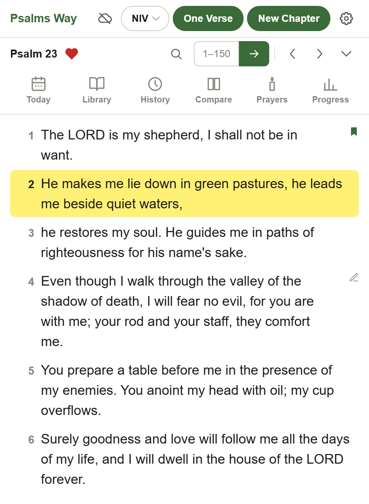
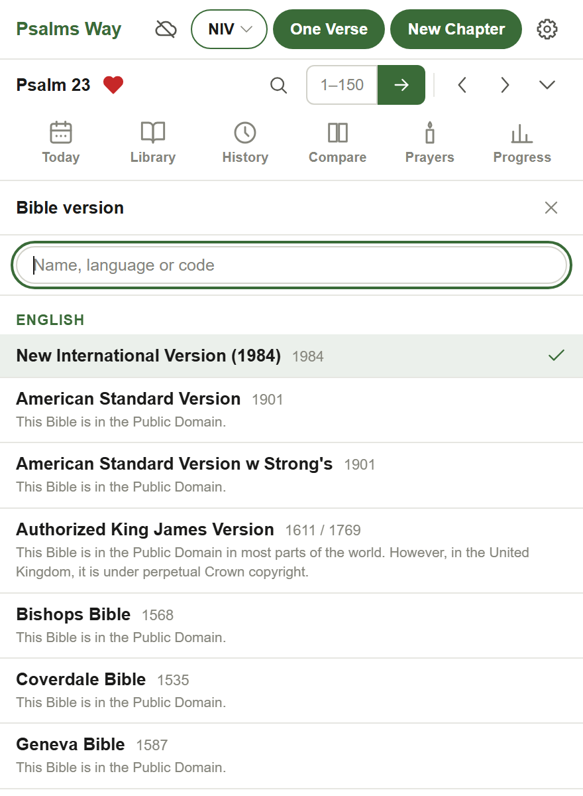
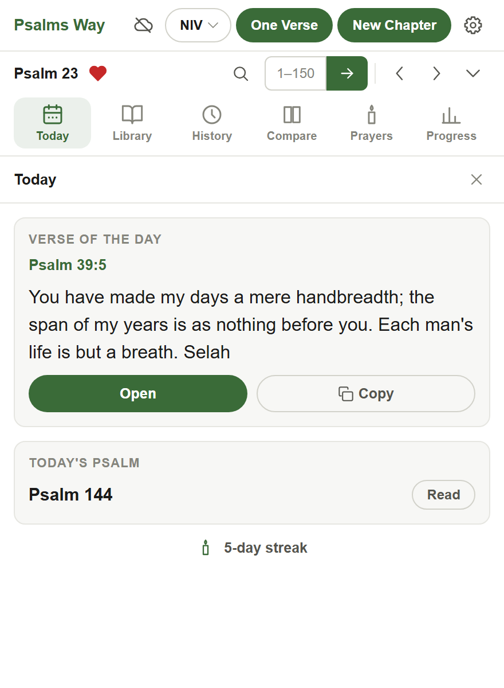
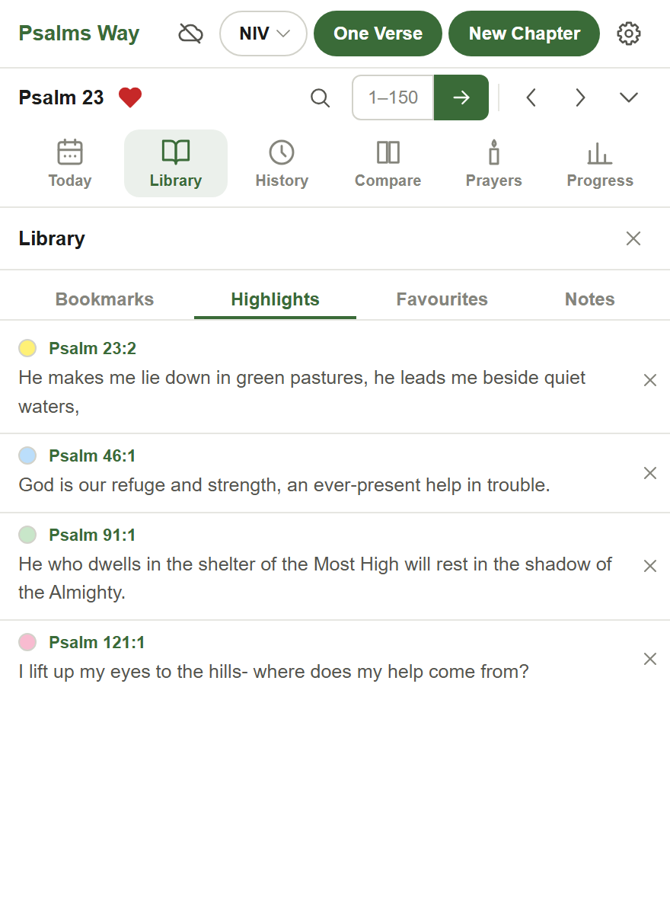
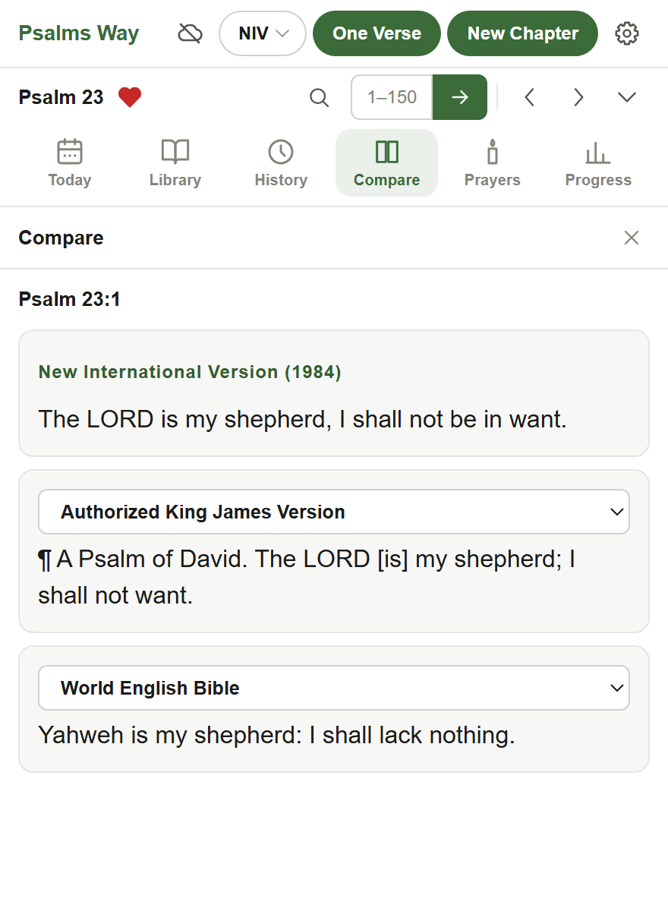
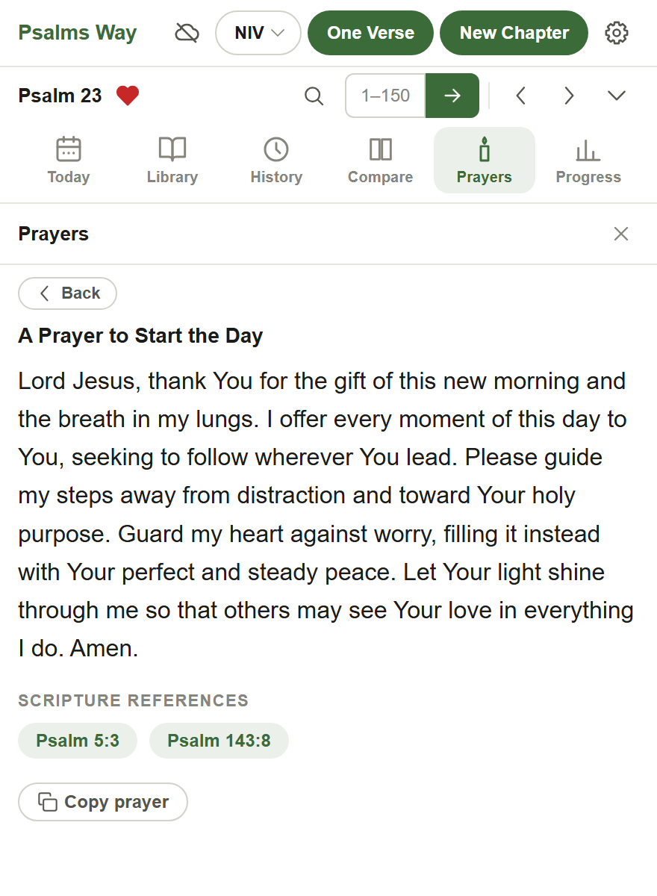
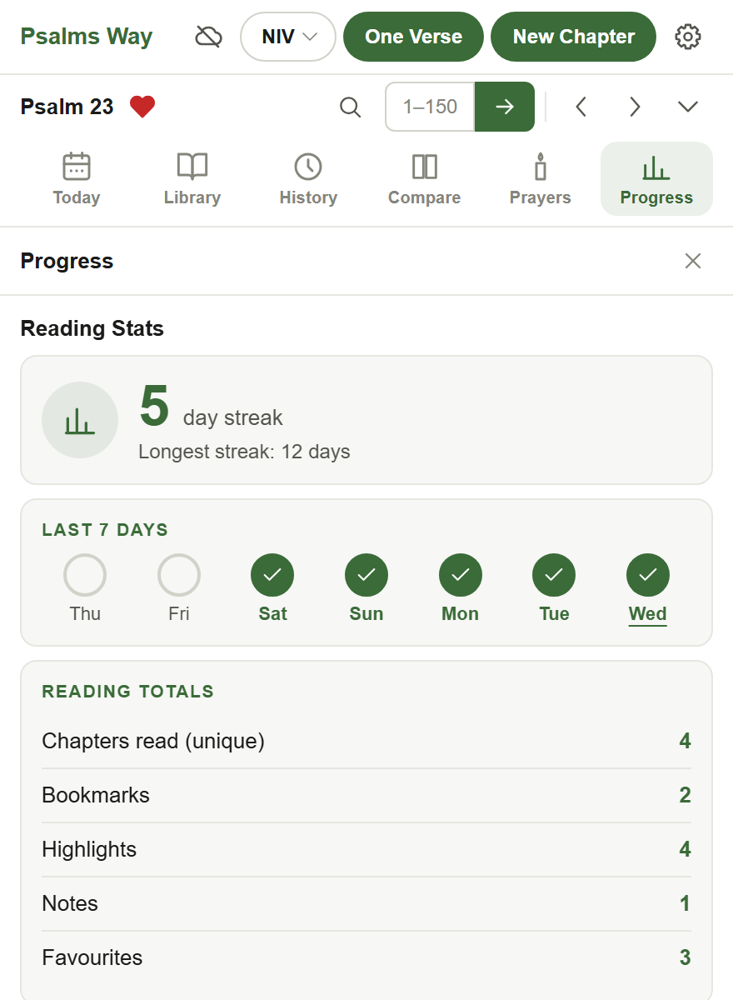
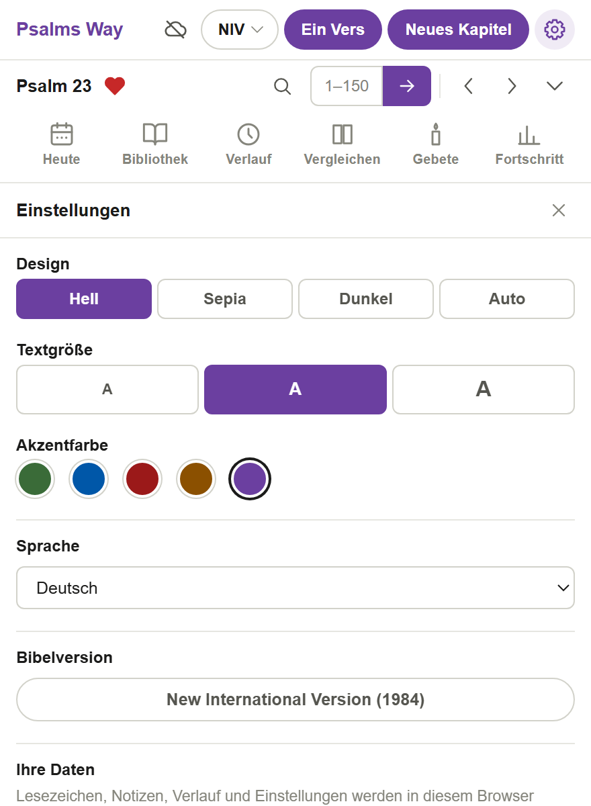

# Psalms Way — user guide

All 150 Psalms, one click away in your browser toolbar, in 80 Bible versions and 47
languages. Everything works offline and stays on your own computer.

## Getting started

Click the Psalms Way icon in your toolbar. The popup opens on whatever you read
last, or on Today's Psalm the first time.

The popup has three parts:

- **The top row** — the Sync cloud, the Bible version button (for English readers it reads
  **NIV** to begin with), the two quick buttons, One Verse and New Chapter, and the
  gear for Settings.
- **The chapter row** — where you are (with a heart to keep the Psalm), and how to
  find or move between Psalms: Search, the number box and Go, then previous and next.
- **The toolbar** — Today, Library, History, Compare, Prayers and Progress.

You can hide the toolbar with the **⌄** button on the right of the chapter row. The
arrow turns up (**⌃**) while the toolbar is hidden; press it to bring the toolbar
back. It stays hidden until you show it again.



---

## Reading

### Bible version

The Bible version button at the top shows which version you are reading. Press it to
open the list of 80 versions. They are grouped by language, with your current
language first, and each shows its year and where its text comes from. Type in the
box to narrow the list by name, language or short code, such as _kjv_.

Choose a version and the popup shows the same Psalm, or the same verse, in it. The
version you choose is remembered. The first time, the popup picks a version in your
browser's language where there is one; English readers start on the NIV (1984). You
can also change it in **Settings → Bible version**.

Reading, Search, Today, the Library and History all use the version you are reading.
Bookmarks, highlights and notes follow a verse's place in the Psalm (Psalm 23, verse
4), so in a few versions that number their verses differently they can sit one verse
off.



### Today

**Today** opens a page with three things:

- **Verse of the day** — one verse a day, the same all day. It is the same verse
  the Psalms Way phone app shows on the same version. **Open** takes you to it in
  its Psalm; **Copy** copies it.
- **Today's Psalm** — one Psalm for the day. It changes at midnight. Nothing is
  downloaded or scheduled: it comes from the date on your computer, so it is the
  same for anyone reading in your time zone on the same day. **Read** opens it.
- **Your streak** — how many days in a row you have opened Psalms Way.



### One Verse

A single verse chosen at random, shown on its own with its reference underneath.
If you have written a note on that verse, it appears below it.

Use **Read Psalm _n_** at the bottom to open the whole chapter around it.

### New Chapter

A whole Psalm chosen at random.

### Moving between Psalms

- **‹** and **›** step to the previous and next Psalm. They wrap around, so
  going back from Psalm 1 takes you to Psalm 150.
- Type a number from 1 to 150 in the box and press the **→** button (Go), or just
  press Enter. If the number is not a Psalm, you are told and nothing moves.
- The **magnifying glass** just before the number box opens Search.

### Doing something with a verse

Click any verse and its buttons appear beneath it:

|               |                                                             |
| ------------- | ----------------------------------------------------------- |
| **Bookmark**  | Add it to your Bookmarks. Click again to remove it.         |
| **Highlight** | Colour it yellow, green, blue or pink, or choose **None**.  |
| **Note**      | Write a note about it.                                      |
| **Copy**      | Copy the verse and its reference, ready to paste.           |
| **Compare**   | See the verse in this version and two others, side by side. |

Copied text looks like this:

```
Psalm 23:1 — The LORD is my shepherd, I shall not be in want.
```

A highlighted verse keeps its coloured background. Small markers on the right of a
verse show at a glance that you have bookmarked it (a ribbon) or written a note on it
(a pencil).

Click the same verse again to close its buttons.

**By keyboard:** Tab to the list of verses, then use ↑ and ↓ to move between
them, Home and End to jump to the start or end, and Enter or Space to open a
verse's buttons.

### Keeping a whole Psalm

Click the **heart** beside the Psalm's title to add the whole Psalm to your
Favourites. The heart fills in. Click it again to remove the Psalm.

---

## Search

Click the **magnifying glass** beside the Psalm number, type at least two
characters, and press Enter. Search looks through the version you are reading.

- Matches are highlighted in the results.
- You are told how many verses matched. If there are more than 50, it says so —
  for example, _Showing first 50 of 812 matches_.
- Clicking a result opens **that exact verse**, not just its chapter.
- Punctuation and symbols are searched for literally, so you can look for
  `LORD.` or `(` without anything odd happening.

Press **Escape** to close Search.

---

## Library

Your Library holds what you have kept, in four tabs.

### Bookmarks

Every verse you have bookmarked, newest first. Click one to open it. Click the **✕**
on the right to remove it.

### Highlights

Every verse you have highlighted, with its colour, in Bible order. Click one to open
it. Click the **✕** to remove the highlight.



### Favourites

The whole Psalms you have kept with the heart. Click one to open the Psalm. Click the
**✕** to remove it.

### Notes

Every note you have written, with the verse it belongs to. Click a note to open
its verse. Click the bin icon to delete it — you are asked to confirm first,
because a deleted note cannot be recovered.

### Writing a note

1. Open a Psalm and click the verse you want to write about.
2. Click **Note**.
3. Type. The verse stays visible above the box so you can see what you are
   writing about.
4. Click **Save**, or press Ctrl+Enter (Cmd+Enter on a Mac).

To change a note later, open the verse and click **Note** again, or open it from
the Library.

To delete a note, either clear the box and save, or use **Delete** in the editor.

Notes can be up to 10,000 characters each.

---

## History

**History** lists the Psalms and verses you have opened, newest first, with when
you read them. Click any entry to go back to it.

The list keeps your 50 most recent passages. Opening something you have read
before moves it back to the top rather than adding a second entry.

**Clear** empties the list. You are asked to confirm. Clearing your history does
**not** touch your bookmarks or your notes.

---

## Compare

**Compare** shows one verse in three Bible versions, one card each: the version you
are reading, then two more. It shows the first verse of the Psalm you are on, or the
verse itself if you are reading a single verse. You can also open it from a verse's
**Compare** button.

Each of the two other cards has its own list of versions, so you can pick any two.
They start as the King James Version and the World English Bible, and your choice is
remembered. To change the first card, change the version at the top.

If a version does not have that verse, its card says so.



---

## Prayers

**Prayers** holds 50 prayers in 19 categories, such as Morning, Night, Healing and
Peace & Anxiety. Choose a category, then a prayer.

- The prayer's **Scripture References** are buttons: click one to read that Psalm.
- **Copy prayer** copies the prayer and its references, ready to paste.
- **Back** returns to the list you came from.

The prayers themselves are in English, as in the phone app. The categories, buttons
and messages are in your language.



---

## Progress

**Progress** is your reading at a glance.

- **Reading Stats** — your current streak and your longest streak, the last seven
  days with a tick on each day you read, and your totals: chapters read,
  bookmarks, highlights, notes and favourite Psalms.
- **Badges** — nine badges for reading streaks, from **First Step** (1 day) to
  **Year of Psalms** (365 days). The heading shows how many you have, such as **1/9**.
  An earned badge shows the day you earned it; a locked one shows what earns it.
- **Challenges** — six reading challenges, from a 7-day **Praise Journey** to the
  40-day **40 Days of Testing**.

The streak counts a day when you open Psalms Way. Opening it on the next day adds
one; missing a day starts again at 1, and your longest streak is never lowered.

To take a challenge, open it and press **Start Challenge**. Each day has one verse
chosen for you. Read it, then press **Mark today's reading as done**. One day counts
per calendar day, so the next is there tomorrow. **Open verse** takes you to the
verse in its Psalm. **Reset challenge** clears your progress, after asking you to
confirm. There are no reminders.



---

## Settings

### Theme

**Light**, **Sepia**, **Dark** or **Auto**. Sepia is a warm, paper-like tone that
some people find easier for long reading. Auto follows your computer's light or
dark setting.

### Text size

Three sizes, applied to the Psalm text.

### Accent colour

Five colours for the popup's buttons and accents: green, blue, red, amber and purple.
They are the same five the phone app has.

### Language

The popup speaks 47 languages. **Automatic** follows your browser's language; or
choose any language, listed by its own name. It changes at once. Arabic, Persian,
Hebrew, Urdu and Uyghur read from right to left, and the popup turns round to
match. The Bible text keeps the direction of the version you are reading.

The Prayers are the one part that is always English.



### Bible version

Shows the version you are reading; press it to choose another.

### Your data

Everything you save (bookmarks, notes, highlights, favourite Psalms, history,
progress and settings) lives on this browser. Unless you turn on Sync it is not sent
anywhere, and it is **deleted if you remove the extension**.

**Export…** saves your bookmarks, notes, highlights, favourite Psalms, history,
streak, badges, challenges and settings to a file named something like
`psalms-way-backup-2026-09-08.json`. Keep it somewhere safe, or move it to another
computer. A file exported by an older version has no highlights or progress in it;
restoring it leaves the ones you have as they are.

**Restore…** reads a file you exported before.

> **Restoring replaces what is on this browser.** You are shown how many
> bookmarks, notes and history entries the file contains, and asked to confirm,
> before anything changes.

If a file is not a Psalms Way backup, is damaged, or was made by a newer version
of the extension, you are told exactly what is wrong and nothing is changed.

---

## Sync with your phone

The cloud button at the top is optional **Sync**. Press it, choose **Connect Google
account**, and sign in with the same Google account you use in the Psalms Way phone
app.

Then your bookmarks, notes, highlights, favourite Psalms, history, streak, badges and
challenge progress stay the same on both. Changes arrive when you open Psalms Way, and
anything you change is sent a few seconds later. Your theme, text size, accent,
language and Bible version are your own on each device.

Everything is kept in a private folder in **your own Google Drive** that only Psalms
Way can see. It goes straight from your browser to Google; there is no Psalms Way
server and we never receive it. Press **Disconnect** at any time: this browser keeps
everything it has, and your Drive copy stays where it is.

---

## Keyboard

| Key             | What it does                                  |
| --------------- | --------------------------------------------- |
| Tab / Shift+Tab | Move between controls                         |
| ↑ ↓             | Move between verses in a chapter              |
| Home / End      | First or last verse                           |
| Enter / Space   | Open the buttons for the selected verse       |
| Enter           | In the chapter box or search box: go / search |
| Escape          | Close the open panel, or cancel a dialog      |
| Ctrl+Enter      | Save a note (Cmd+Enter on a Mac)              |

When you close a panel, focus goes back to the button you opened it with, so you
do not lose your place.

---

## Privacy

- Without sync, the extension makes **no network requests at all**. Everything,
  including every Psalm in every version, is bundled inside it.
- It has **no permission to read the pages you visit** — it cannot see your
  browsing at all.
- Signing in is optional and only for sync. There are no analytics and no tracking.
- Sync stores your data in a private app folder in **your own Google Drive** that
  only Psalms Way can see. It goes straight from your browser to Google; we never
  receive it.
- The only permission it asks for is `storage`, which is what keeps your
  bookmarks, notes, highlights, history, progress and settings on your own machine.
  Connecting sync asks for one more, `identity`, at that moment and not before.

The full policy is in [PRIVACY.md](PRIVACY.md).

---

## Common questions

**Will my bookmarks and notes sync to my phone?**
Yes, if you choose. Press the cloud button at the top and connect the same Google
account you use in the Psalms Way phone app. Bookmarks, notes, highlights, favourite
Psalms, history, streaks, badges and challenges then stay the same on both: changes
arrive when you open Psalms Way, and anything you change is sent within a few
seconds. Deleting something on one device deletes it on the other.

**What if this browser ends up with nothing saved?**
Sync pauses rather than empty your Google account, and asks you to choose:
**Get my data back** or **Sync anyway**.

**Does it still work with no internet?**
Yes, entirely. Sync catches up the next time you are online.

**Will I lose my saved verses when I update the extension?**
No. Bookmarks, history and settings saved by earlier versions are carried
forward automatically.

**What happens if I uninstall it?**
Chrome deletes the extension's stored data. Connect sync, or export a backup, first
if you want to keep your notes.

**Which Bible versions are there?**
80, in 46 languages, from the phone app's Bible files. Open the Bible version button
to browse them, and see each one's credit line. The NIV (1984) is the default for
English. See the licence note in the [README](README.md).

**Are there reminders?**
No. The phone app has them; the extension does not send notifications.

**Why is a verse in Compare or the Library one verse off?**
A few versions number their verses differently (some count a Psalm's heading as
verse 1). Bookmarks, highlights and notes keep a verse's place in the Psalm, so
there they can sit a verse away.

---

## Something went wrong

Messages appear briefly at the bottom of the popup.

| Message                                                  | What it means                                           |
| -------------------------------------------------------- | ------------------------------------------------------- |
| _That bookmark could not be saved._                      | The browser refused the write. Usually storage is full. |
| _There is no room left in browser storage._              | Clear your history or delete some notes.                |
| _Your browser blocked the copy._                         | Select the verse and press Ctrl+C instead.              |
| _That file is not a Psalms Way backup._                  | You picked the wrong file.                              |
| _That backup was made by a newer version of Psalms Way._ | Update the extension, then restore again.               |
| _The Psalms text could not be loaded._                   | Reload the extension from `chrome://extensions`.        |
| _The prayers could not be loaded._                       | Reload the extension from `chrome://extensions`.        |

If something keeps going wrong, please
[open an issue](https://github.com/atj393/psalms-way-browser-extension/issues)
or use the
[feedback form](https://docs.google.com/forms/d/e/1FAIpQLSda0j_4GX_E_aFhsyItJssbgRc6C7Ukg-No54Gc0Sivzt5iSA/viewform?usp=sf_link).
